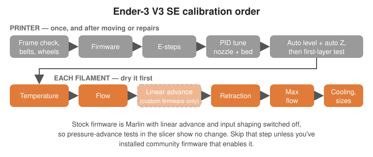
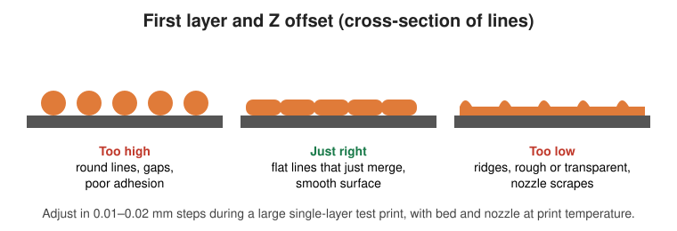
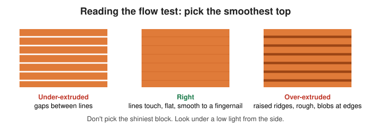
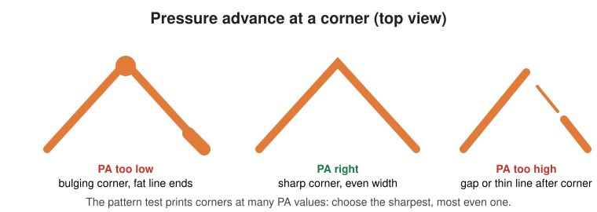

# Calibrating the Ender-3 V3 SE: What Works and What Doesn't

A practical calibration guide for the Creality **Ender-3 V3 SE**, using the printer's built-in
routines, **Creality Print** and **OrcaSlicer**. Each step says what to do, what reliably works and
what tends to go wrong.

The SE runs **Marlin**, not Klipper. Several calibrations common on newer printers (pressure
advance, input shaping) **don't work on stock firmware** — this guide says where.

Settings that build on these results: [Print Settings](print-settings.md).

Modified your printer? See [what to recalibrate after each mod](modifications.md#what-to-recalibrate-after-each-mod).

## Contents

1. [Order matters](#1-order-matters)
2. [Sending G-code commands](#2-sending-g-code-commands)
3. [Mechanical check](#3-mechanical-check)
4. [E-steps](#4-e-steps)
5. [PID tuning](#5-pid-tuning)
6. [Z offset and first layer](#6-z-offset-and-first-layer)
7. [Temperature](#7-temperature)
8. [Flow rate](#8-flow-rate)
9. [Pressure advance / linear advance](#9-pressure-advance--linear-advance)
10. [Max volumetric speed](#10-max-volumetric-speed)
11. [Retraction](#11-retraction)
12. [Ringing and input shaping](#12-ringing-and-input-shaping)
13. [Cooling, dimensions and tolerances](#13-cooling-dimensions-and-tolerances)
14. [Community firmware](#14-community-firmware)
15. [Summary: what works on the stock SE](#15-summary-what-works-on-the-stock-se)
16. [Recording results](#16-recording-results)
17. [Sources](#17-sources)

---

## 1. Order matters

**Printer (once, and after moving it or changing parts):**
1. Mechanical check → 2. Firmware → 3. E-steps → 4. PID → 5. Auto level + Z offset + first-layer
   test

**Each new filament:**
6. Temperature → 7. Flow → (8. Linear advance, custom firmware only) → 9. Retraction →
10. Max volumetric speed → 11. Cooling, dimensions

Calibrate **e-steps before the first layer and flow** — wrong e-steps make every later test
misleading. A community guide based on Creality's Discord advice also suggests going back to the
first layer after flow calibration, and repeating first layer, flow, temperature and retraction
whenever you change to a different filament.

## 2. Sending G-code commands

Several steps need Marlin G-code. The SE has no network or console, so either:

- **Connect by USB** to a computer and use a terminal (Pronterface, OctoPrint, or the console in
  Creality Print/Orca if your version has one), or
- **Write the commands into a `.gcode` text file**, copy it to the SD card/USB stick, and "print"
  it. Add `M500` at the end to save to EEPROM.

Always read current values first with `M503` and write them down.

## 3. Mechanical check

**What works**
- Check all frame bolts, the gantry square, and that the X gantry is level with the bed.
- **Belt tension:** firm, low "twang"; equal feel on X and Y. Slack belts cause ringing and
  inaccurate sizes.
- **Eccentric nuts/wheels:** no wobble, but the wheel should still turn with a finger. Too tight
  causes flat spots and Z banding.
- **Lead screws:** clean and lightly lubricate; check the Z coupler isn't slipping.
- Put the printer on a **heavy, solid surface** — a bed-slinger shakes light tables.

**What doesn't**
- Software calibration can't compensate for loose belts, wobbly wheels or a twisted gantry.

## 4. E-steps

E-steps tell the extruder how far to push filament. Get this right before flow.

1. Heat the nozzle to printing temperature.
2. Mark the filament **120 mm** above the extruder entry.
3. Send `M83` then `G1 E100 F100` (extrude 100 mm slowly).
4. Measure the distance from the mark to the extruder; **extruded = 120 − remaining**.
5. Read current steps with `M503` (`M92 E…`).
6. New value = **current × 100 ÷ extruded**. Set it with `M92 E<new>` and save with `M500`.
7. Repeat once to confirm (within ±1 mm).

**What works:** measuring slowly (F100) at print temperature, with a fresh mark each time.

**What doesn't:** measuring at the nozzle with the hotend cold; using flow ratio in the slicer to
fix a large e-steps error (it hides the problem filament by filament).

## 5. PID tuning

Keeps nozzle and bed temperature steady — unstable temperature shows as banding.

- Nozzle: `M303 E0 S210 C8 U1` (tune at your usual temperature; `U1` applies the result).
- Bed: `M303 E-1 S60 C8 U1`.
- Save: `M500`.

Run with the part fan at its usual speed for the nozzle tune if you print with high fan. Redo after
replacing the heater or thermistor. If your firmware menu offers PID autotune, that works too.

## 6. Z offset and first layer

The SE probes the bed with the **CR Touch** (auto bed levelling) and sets the Z offset
automatically with a **load sensor** in the nozzle assembly.

**What works**
- Clean the bed and nozzle tip (no plastic blob on the nozzle — it upsets the auto Z offset).
- Run **auto levelling** with the bed at printing temperature after a few minutes of heating.
- Then print a **large single-layer square** and **fine-tune the Z offset live** from the printer
  menu in **0.01–0.02 mm** steps until lines just merge, with no gaps and no ridges. Save it.
- Make sure the start G-code runs `G29` (mesh) or loads the saved mesh — check your slicer's machine
  start G-code.

**What doesn't (or is disputed)**
- Trusting the automatic Z offset blindly: guides note it "nominally" sets the offset, but
  final tuning by test print is still needed.
- Re-running auto Z offset with filament oozing from the nozzle — it measures the blob.
- Lowering Z offset to fix adhesion when the bed is greasy — wash the plate with warm water and
  washing-up liquid instead.
- Forum threads report first layers too close after auto Z on some units; live-adjusting and
  saving the offset is the reliable fix.

## 7. Temperature

**Tool:** Orca → Calibration → Temperature tower (also in Creality Print's Calibration menu).

**What works**
- 5 °C steps across the spool's range. Choose the coolest step with good layer bonding (snap it
  by hand), clean overhangs and minimal stringing.
- Calibrate at the speeds you'll actually use.

**What doesn't**
- Using Creality's 190 °C CR-PLA value for other PLA brands — most need 200–215 °C.

## 8. Flow rate

**Tool:** Orca → Calibration → Flow rate → Pass 1, then Pass 2.

**What works**
- After e-steps and temperature. Choose the block with the smoothest top surface — no gaps, no
  ridges — under light from the side; refine with Pass 2.
- Store the result in the **filament** profile (flow ratio).

**What doesn't**
- Picking the shiniest block.
- Large flow corrections (beyond about ±8 %) — recheck e-steps instead.
- The "YOLO" Archimedean-chords pattern divides opinion; use the classic two-pass test if it's
  hard to read.

## 9. Pressure advance / linear advance

**On stock firmware: doesn't work.**

The SE's Marlin firmware has linear advance (Marlin's version of pressure advance) **turned off**.
Users report that Orca's and Creality Print's PA tests — and G-code changing `M900 K` per layer —
produce no visible difference at any value.

What to do instead:
- Turn **"Enable pressure advance" off** in filament profiles.
- Keep outer wall speed **slow and even** and acceleration moderate; use scarf seams.
- If you need sharper corners at higher speed, **community firmware** enables linear advance
  (`M900`) — see [section 14](#14-community-firmware). Then run Orca's PA pattern or tower test.

## 10. Max volumetric speed

**Tool:** Orca → Calibration → Max flowrate.

**What works**
- Run at the top of the filament's temperature range.
- Note where walls first turn rough or thin; set MVS **10–20 % below** that.
- Typical stock-hotend results: around **10–15 mm³/s PLA, 6–10 mm³/s PETG** — measure yours.

**What doesn't**
- Using the highest value seen once; it fails on long prints.
- For quality printing MVS rarely limits you — the outer wall is far slower.

## 11. Retraction

**Tool:** Orca → Calibration → Retraction test.

**What works**
- Start from Creality's values (PLA 0.8 mm, PETG 1.5 mm, TPU 2.0 mm at 25 mm/s) and step by
  0.1–0.2 mm. Pick the shortest length that stops strings.
- Dry filament and settle temperature first.

**What doesn't**
- Retraction above ~2 mm on this direct-drive extruder — heat creep and clogs.
- Tuning retraction on a wet spool.

## 12. Ringing and input shaping

**On stock firmware: no input shaping.**

What works instead:
- Lower **outer wall acceleration** to 1,000–1,500 mm/s² and outer wall speed to 40–60 mm/s.
- Tighten belts; adjust eccentric wheels; solid surface.
- Orient tall parts so their long side runs along X (the bed's Y motion carries more mass).
- Orca's **ringing tower / input shaping** tests only help if your firmware supports `M593`
  (community firmware).

## 13. Cooling, dimensions and tolerances

- **Overhang/bridge tests** to set fan and overhang speeds; the side-mounted fan cools one side
  better — orient overhangs towards it.
- **Calibration cube** (20 mm) or larger 100 mm parts, measured with calipers.
- **X-Y hole compensation** and **contour compensation** in Orca for fitting parts; use the
  tolerance test.
- **Elephant's foot compensation** 0.1–0.2 mm.
- Don't change X/Y/Z steps to fix small errors — usually flow, belts or compensation are the cause.

## 14. Community firmware

Community Marlin builds for the SE (for example the navaismo Ender-3V3-SE project) add:
- **Linear advance** via `M900` or the slicer.
- **Input shaping** via `M593`.
- Other menu and levelling improvements.

**Cautions**
- The SE has **different mainboard revisions (C13 and C14)**. Flashing the wrong build can leave the
  board unbootable. Check your board before downloading.
- It isn't supported by Creality; keep a copy of the stock firmware to go back.
- After flashing: re-run e-steps, PID, levelling and Z offset; then add linear advance to the
  per-filament calibration.
- More options, including Klipper via the Sonic Pad, Nebula Pad or a Raspberry Pi, are in
  [Suggested Modifications](modifications.md#1-firmware-linear-advance-and-input-shaping).

## 15. Summary: what works on the stock SE

| Calibration | Stock SE | Recommendation |
|---|---|---|
| Mechanical (belts, wheels, frame) | ✅ Manual | Essential first step |
| E-steps | ✅ `M92` + `M500` | Do once, before flow |
| PID | ✅ `M303` | After heater changes |
| Auto bed level + auto Z | ✅ Built in | Then fine-tune by first-layer test |
| Temperature | ✅ Tower | Per filament |
| Flow | ✅ Two-pass test | Per filament |
| Pressure / linear advance | ❌ Disabled | Off in profiles; community firmware to enable |
| Input shaping | ❌ Not available | Lower acceleration instead |
| Retraction | ✅ Tower | After drying |
| Max volumetric speed | ✅ Tower | Keep a margin |
| Dimensions/tolerance | ✅ Cube/tolerance test | For functional parts |

## 16. Recording results

| Filament | Dried? | Temp °C | Flow | MVS | Retraction | Fan % | Notes |
|---|---|---|---|---|---|---|---|
| *e.g. Brand PLA, white* | | | | | | | |
| | | | | | | | |

Printer values to note: e-steps, nozzle and bed PID values, saved Z offset, firmware version.

## 17. Sources

Compiled November 2026 from:

- Creality — [Ender-3 V3 SE support page](https://www.creality.com/support/creality-ender-3-v3-se), [Ender-3 V3 SE material guide (PDF)](https://wiki.creality.com/products/diy/ender%E7%B3%BB%E5%88%97/ender-3v3se/ender-3_v3_se_material_guide.pdf), [How to calibrate a 3D printer](https://www.creality.com/blog/how-to-calibrate-a-3d-printer)
- Creality Forum — [Ender-3 V3 SE pressure advance](https://forum.creality.com/t/ender-3-v3-se-pressure-advance/2648), [Roll our own firmware (SE)](https://forum.creality.com/t/ender-3-v3-se-config-settings-to-roll-our-own-firmware-please/6333?page=22), [Ender-3 V3 SE Z offset](https://forum.creality.com/t/ender-3-v3-se-z-offset/19754), [First layer too close](https://forum.creality.com/t/first-layer-too-close/13395?page=2)
- navaismo — [Ender-3V3-SE community firmware](https://github.com/navaismo/Ender-3V3-SE), [v1.1.0 release notes](https://newreleases.io/project/github/navaismo/Ender-3V3-SE/release/v1.1.0)
- mriscoc Ender3V2S1 wiki — [Linear Advance](https://github.com/mriscoc/Ender3V2S1/wiki/Linear-Advance-(LA)), [Input Shaping](https://github.com/mriscoc/Ender3V2S1/wiki/Input-Shaping-(IS)), [Calibration guides](https://github.com/mriscoc/Ender3V2S1/wiki/Calibration-Guides)
- blekenbleu — [Ender-3 V3 SE tuning and calibration](https://blekenbleu.github.io/static/Ender3V3SE/calibrate.htm)
- What's the Process For — [Dialing in an Ender-3 V3 SE](https://www.whatstheprocessfor.com/process/dialing-in-a-creality-ender-3-v3-se-3d-printer)
- DREMC — [Retraction tuning in OrcaSlicer](https://support.dremc.com.au/support/solutions/articles/51000389391-retraction-tuning-for-ender-3-v3-se-ke-using-orca-slicer)
- OrcaSlicer Wiki — [Calibration guide](https://www.orcaslicer.com/wiki/guides/calibration_guide.html), [Flow ratio](https://www.orcaslicer.com/wiki/calibration/flow_ratio_calib), [Pressure advance](https://www.orcaslicer.com/wiki/calibration/pressure_advance_calib.html), [Volumetric speed](https://www.orcaslicer.com/wiki/calibration/volumetric_speed_calib.html)
- Obico — [OrcaSlicer calibration guide](https://www.obico.io/blog/orcaslicer-comprehensive-calibration-guide/)
