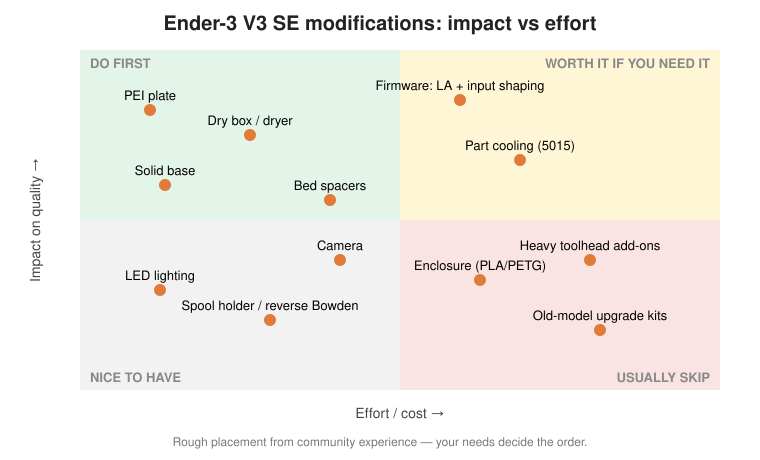

# Suggested Modifications for the Ender-3 V3 SE

Which upgrades are worth doing on a Creality **Ender-3 V3 SE**, in order of impact on print quality
and reliability, and which ones usually aren't. Hotend upgrades are deliberately not covered here.

After any modification, recalibrate what it affects — see
[What to recalibrate after each mod](#what-to-recalibrate-after-each-mod) and
[Calibration](calibration.md).

## Contents

1. [Firmware: linear advance and input shaping](#1-firmware-linear-advance-and-input-shaping)
2. [PEI build plate](#2-pei-build-plate)
3. [Dry filament storage](#3-dry-filament-storage)
4. [A solid base](#4-a-solid-base)
5. [Part cooling](#5-part-cooling)
6. [Bed mounting](#6-bed-mounting)
7. [Nice to have](#7-nice-to-have)
8. [Usually not worth it](#8-usually-not-worth-it)
9. [What to recalibrate after each mod](#what-to-recalibrate-after-each-mod)
10. [Sources](#10-sources)

---

## 1. Firmware: linear advance and input shaping

**Impact: high · Cost: free to moderate · Difficulty: medium**

The stock Marlin firmware has **linear advance** (pressure advance) and **input shaping** switched
off. These are the two features that let you print faster without bulging corners, blobby seams
and ringing. Two routes:

### A. Community Marlin firmware (free)

- Builds such as the **navaismo Ender-3V3-SE** project enable linear advance (`M900` or from the
  slicer) and input shaping (`M593`), plus menu improvements.
- **Check your mainboard revision (C13 or C14) first.** Flashing a build for the wrong board can
  leave it unbootable.
- Keep the stock firmware file so you can go back. Not supported by Creality.

### B. Klipper

| Option | Notes |
|---|---|
| **Creality Sonic Pad** | Tablet with Creality-customised Klipper; adds Wi-Fi, built-in accelerometer (G-sensor) calibration for input shaping. Cons: closed OS, no Klipper add-ons/plugins, slow. **Needs a separate serial cable for the SE — USB-C doesn't work.** |
| **Creality Nebula Pad** | Community wiki covers the SE, including input shaping and a dual-fan cooling add-on. |
| **Raspberry Pi** (Mainsail/Fluidd) | Most flexible and open; needs more setup and an accelerometer (ADXL345) for input shaping. |

Klipper gives full **pressure advance**, measured **input shaping**, network printing, a web
interface and macros. It changes how you calibrate (Klipper commands instead of Marlin `M`-codes).

**After either route:** turn on pressure advance in filament profiles and run the slicer's
pressure advance test; run input shaping; you can then raise outer wall acceleration a little.

## 2. PEI build plate

**Impact: high · Cost: low · Difficulty: easy**

A smooth or textured **PEI spring-steel plate** gives consistent first layers and parts that pop off
when the plate is flexed. Wash it with warm water and washing-up liquid; wipe with IPA between
prints. Textured PEI hides first-layer flaws and gives a textured underside; smooth PEI gives a
glossy one.

## 3. Dry filament storage

**Impact: high · Cost: low–moderate · Difficulty: easy**

A filament dryer or dry box that feeds straight to the printer. Creality marks a dry box as
recommended for PETG. Wet filament causes stringing, rough walls, bubbles and inconsistent flow
that no setting fixes. Dry PETG and TPU every time; PLA if it's been out for weeks.

## 4. A solid base

**Impact: medium–high · Cost: low · Difficulty: easy**

The SE moves its bed in Y, so the whole printer rocks. A heavy slab (paving stone, worktop offcut)
under it reduces ringing more than most printed mods. Be careful with soft rubber feet: on a
bed-slinger they can let the printer rock more and make ringing worse — test before and after.

## 5. Part cooling

**Impact: medium · Cost: low · Difficulty: medium**

The stock single side fan is the SE's weak spot for overhangs and bridges. Popular printed mods:

- **Dual 5015 blower duct** — air from both sides; its designer found the stock shroud fine but
  cooling short.
- **5015 mount with dual-sided outlet** — reported better overhangs, less stringing and less noise.
- **Lightweight 4010 shroud** — keeps the stock fan, better airflow, less weight.

**Check the power draw first.** A larger blower can draw much more current than the toolhead board
was designed for (one forum report on a sister model noted about double). Use 24 V fans of a
similar rating, or follow the mod's wiring guide. Extra weight on the print head also increases
ringing — prefer lightweight designs.

## 6. Bed mounting

**Impact: medium · Cost: low · Difficulty: medium**

Stiffer bed springs or **solid silicone spacers** in place of the stock springs hold the bed level
for longer, so the auto-level mesh and Z offset stay valid between prints. Re-level and re-set the
Z offset after fitting.

## 7. Nice to have

| Mod | Why |
|---|---|
| **Camera** (e.g. Logitech C270) with OctoPrint or Klipper | Watch prints remotely; a C270 is enough for monitoring |
| **LED lighting** | Better view and time-lapses |
| **Reverse Bowden tube / side spool holder** | Less drag on the extruder; helps TPU |
| **Quiet fan mod** | Noise; check current draw as above |
| **Clog-clearing tool** | Keep one to hand |

## 8. Usually not worth it

- **An enclosure for PLA or PETG** — PLA prints worse in a warm box (heat creep, soft walls). Only
  worth it for ABS/ASA, and the 260 °C nozzle and 100 °C bed limit what you can print anyway.
- **Upgrade parts for older Ender-3 models** — many don't fit the V3 frame; check before buying.
- **Heavy print-head add-ons** — extra mass increases ringing.
- **"Speed" kits** without firmware support — speed is limited by acceleration, cooling and flow,
  not by the parts.
- In general, check reviews: some popular "improvements" make prints worse.

## What to recalibrate after each mod

| Modification | Recalibrate |
|---|---|
| Community Marlin firmware | E-steps, PID, bed level, Z offset; then linear advance and input shaping per filament/printer |
| Klipper (Sonic Pad / Nebula Pad / Pi) | Everything: rotation distance (e-steps), PID, mesh, Z offset, pressure advance, input shaping |
| PEI plate | Bed mesh, Z offset (first-layer test) |
| Bed springs/spacers | Manual level, bed mesh, Z offset |
| Part cooling | Overhang/bridge tests, fan % per filament; ringing check if heavier |
| Solid base | Ringing check; input shaping if available |
| Dry box/dryer | Flow and retraction if the filament was previously damp |

## 10. Sources

Compiled November 2026. Prices and specific mods change often; check each model page for
compatibility with the V3 SE.

- All3DP — [Best Ender-3 V3 SE upgrades](https://all3dp.com/2/best-ender-3-v3-se-upgrade/)
- Creality — [Ender-3 V3 SE upgrades](https://store.creality.com/blog/ender-3-v3-se-upgrades), [Ender-3 V3 SE material guide (PDF)](https://wiki.creality.com/products/diy/ender%E7%B3%BB%E5%88%97/ender-3v3se/ender-3_v3_se_material_guide.pdf)
- Creality Forum — [Ender-3 V3 SE upgrades](https://forum.creality.com/t/ender-3-v3-se-upgrades/23422), [Ender-3 V3 part cooling upgrades](https://forum.creality.com/t/ender-3-v3-part-cooling-upgrades/19824), [SE pressure advance](https://forum.creality.com/t/ender-3-v3-se-pressure-advance/2648)
- Awesome resources for the Ender-3 V3 SE — [GitHub index (archived)](https://github.com/pwlgrzs/awesome-resources-for-ender-3-v3-se), [current GitBook](https://pblvsky.gitbook.io/ender3v3se/)
- navaismo — [Ender-3V3-SE community firmware](https://github.com/navaismo/Ender-3V3-SE)
- Nebula Pad SE wiki — [Dual fan cooling](https://lukosiupro.github.io/Ender3-v3-SE-Nebula-Pad-Wiki/addons/dual-fan-cooling)
- Printables — [Dual 5015 blower duct for SE](https://www.printables.com/model/667051-dual-5015-blower-duct-for-ender-3-v3-se), [SE 5015 fan upgrade](https://www.printables.com/model/776657-ender-3-v3-se-5015-fan-upgrade), [Lightweight 4010 shroud](https://www.printables.com/model/1007680-ender-v3-se-lightweight-4010-fan-shroud-duct), [SE fan wiring guides](https://www.printables.com/model/942165-ender-3-v3-se-fan-upgrade-wiring-guides), [Silent setup mod](https://www.printables.com/model/1105329-mufflermod-ender3-v3-se-silent-setup)
- MakerWorld — [SE mod collection](https://makerworld.com/models/2739128)
- Gambody — [Ender-3 upgrades: check before you buy](https://www.gambody.com/blog/?p=21827)
