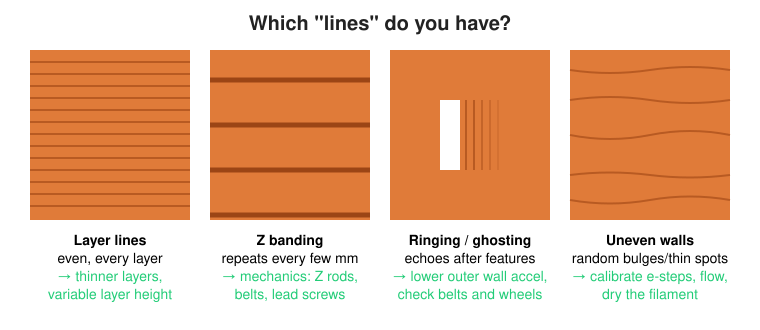
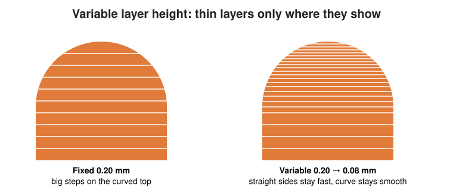
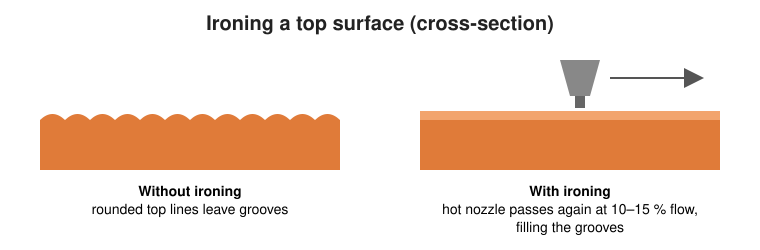
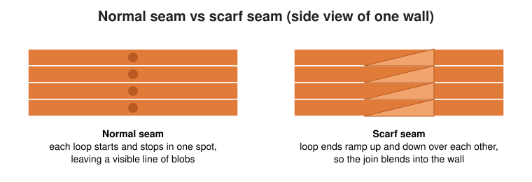
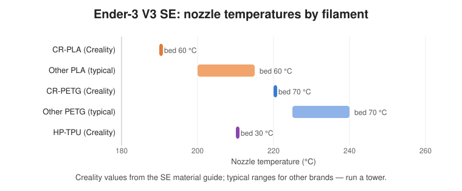
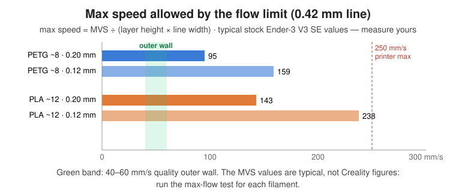
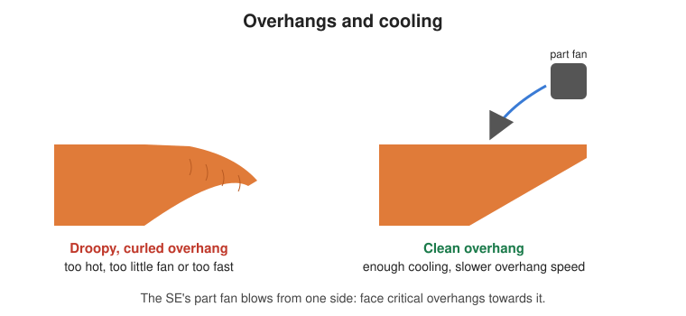
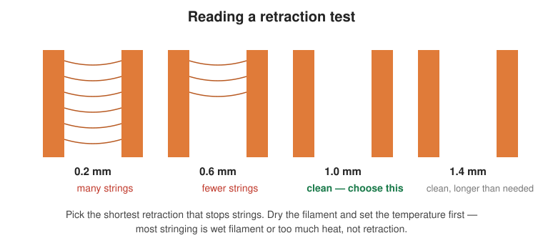

# Print Settings for Quality on the Creality Ender-3 V3 SE

Suggested settings for a stock Creality **Ender-3 V3 SE** with its 0.4 mm nozzle, sliced in
**Creality Print** or **OrcaSlicer**. The goal is a clean surface with minimal layer lines rather
than the fastest print.

Creality Print is built on the same code base as OrcaSlicer, so almost every setting below has
the same name in both.

Calibrate first: settings only work as well as the printer and filament are tuned. See
[Calibration](calibration.md).

## Contents

1. [The printer and its limits](#1-the-printer-and-its-limits)
2. [Which slicer for what](#2-which-slicer-for-what)
3. [Quality profile at a glance](#3-quality-profile-at-a-glance)
4. [Reducing layer lines](#4-reducing-layer-lines)
5. [Smooth top surfaces](#5-smooth-top-surfaces)
6. [Seams](#6-seams)
7. [Temperatures by filament](#7-temperatures-by-filament)
8. [Speeds, acceleration and volumetric flow](#8-speeds-acceleration-and-volumetric-flow)
9. [Cooling](#9-cooling)
10. [Retraction and stringing](#10-retraction-and-stringing)
11. [Building quality presets](#11-building-quality-presets)
12. [Smoothing after printing](#12-smoothing-after-printing)
13. [Quick troubleshooting](#13-quick-troubleshooting)
14. [Sources](#14-sources)

---

## 1. The printer and its limits

| | Ender-3 V3 SE |
|---|---|
| Build volume | 220 × 220 × 250 mm |
| Max print speed (rated) | 250 mm/s |
| Typical speed (Creality) | 180 mm/s |
| Max acceleration | 2,500 mm/s² |
| Max nozzle temperature | 260 °C |
| Max bed temperature | 100 °C |
| Extruder | Direct drive |
| Levelling | CR Touch auto bed levelling + automatic Z offset (load sensor) |
| Enclosure | None |
| Firmware | Marlin (not Klipper) — **linear advance and input shaping are off in stock firmware** |

What this means for quality:

- It's a **bed-slinger** (the bed moves in Y), so tall, thin parts and high Y accelerations show
  ringing sooner than on a CoreXY printer. Keep acceleration moderate.
- **No pressure advance** on stock firmware: slow down the outer wall and keep speeds even, so
  corners and seams don't bulge.
- **No input shaping** on stock firmware: ringing is controlled with acceleration, belt tension and
  a solid surface.
- **No enclosure, 260 °C max:** PLA, PETG and TPU are the comfortable materials. ABS/ASA are
  possible only in a draught-free room with an improvised enclosure; PC and nylon are out of range.

## 2. Which slicer for what

| | Creality Print | OrcaSlicer |
|---|---|---|
| Ender-3 V3 SE profile | ✅ Built in | ✅ Built in |
| Calibration tests | ✅ Calibration menu | ✅ Most complete and documented |
| Sending prints | USB stick / SD | USB stick / SD (no network on the SE) |
| Scarf seams, ironing, variable layer height | ✅ | ✅ |

Either works. OrcaSlicer's calibration tests and wiki make it the better place to tune; copy the
results into presets in whichever slicer you use day to day.

**Pressure advance in the slicer:** leave **"Enable pressure advance" off** in filament profiles
with stock firmware — it does nothing, and the Creality Print/Orca PA tests show no change.

## 3. Quality profile at a glance

Start from **"0.20mm Standard @Creality Ender-3 V3 SE 0.4 nozzle"** (Creality Print) or the Orca
equivalent, and change:

| Setting | Standard | **Quality** | **Fine detail** |
|---|---|---|---|
| Layer height | 0.20 mm | **0.12–0.16 mm** | **0.08–0.10 mm** |
| First layer height | 0.20 mm | 0.20 mm | 0.20 mm |
| Line width (outer wall) | 0.42 mm | 0.42 mm | 0.40 mm |
| Wall loops | 2 | **3** | 3 |
| Wall generator | Classic | **Arachne** | Arachne |
| Wall order | Inner/outer | Inner/outer (inner/outer/inner with scarf seams) | Inner/outer |
| Precise outer wall | Off | **On** | On |
| Outer wall speed | 100–150 mm/s | **40–60 mm/s** | 30–40 mm/s |
| Inner wall speed | 150+ mm/s | 80–120 mm/s | 60–80 mm/s |
| Infill speed | 180+ mm/s | 120–180 mm/s | 100 mm/s |
| Outer wall acceleration | 2,500 | **1,000–1,500 mm/s²** | 800–1,000 mm/s² |
| Default / infill acceleration | 2,500 | 1,500–2,000 mm/s² | 1,500 mm/s² |
| Travel acceleration | 2,500 | 2,500 mm/s² | 2,500 mm/s² |
| Top surface speed | 100+ mm/s | 60–80 mm/s | 50 mm/s |
| Top shell layers | 5 | 6–7 (at 0.12 mm) | 8–10 |
| Top surface pattern | Monotonic line | Monotonic line | Monotonic line |
| Ironing | Off | **Top surfaces** | Top surfaces |
| Seam | Aligned | Aligned or back + scarf | Same |
| Infill | 15% grid | 15–20% **gyroid** | 15% gyroid |

These are starting points from slicer documentation and community practice, not Creality-published
values; test with your filament.

## 4. Reducing layer lines

First, look at what kind of lines you have:



| What you see | Cause | Fix |
|---|---|---|
| Even, fine ridges everywhere | Layer height | Lower layer height; variable layer height |
| Ridges at a regular interval | Z banding: lead screw, Z coupler, eccentric wheels | Clean and lightly lubricate the lead screws; check couplers and wheel tension |
| Ripples after corners and holes | Ringing | Lower outer wall acceleration; tighten belts; solid surface |
| Random bulges or thin layers | E-steps or flow not calibrated, wet filament | [Calibrate](calibration.md); dry the filament |
| Bulging corners and seams | No pressure advance on stock firmware | Slower outer wall, lower acceleration, scarf seams; or community firmware with linear advance |
| Lines worse in Y than X | Bed (Y axis) moving mass | Lower acceleration; orient long features along X |

### Settings that help most

1. **Lower layer height** — 0.12 mm makes a big difference; below 0.08 mm the gain is small.
2. **Variable layer height** — thin layers only on curves and slopes. Smooth the result to avoid
   visible steps. (Organic tree supports don't work with variable layer height.)
3. **Slow, gentle outer wall** — 40–60 mm/s and 1,000–1,500 mm/s² on a bed-slinger.
4. **Even speeds** — without pressure advance, sudden speed changes show as width changes; keep
   outer wall, small perimeter and overhang speeds close together.
5. **Precise outer wall** and **Arachne**.
6. **Calibrated e-steps and flow**; **dry filament**.
7. **Orientation** — layer lines are least visible on vertical walls, most visible on shallow
   slopes.



### Hide them instead

- **Fuzzy skin** on the outer wall.
- **Matte or silk** filaments.
- A **textured build plate** for textured bottoms.

## 5. Smooth top surfaces



- **Ironing** on top surfaces: flow 10–15 %, spacing 0.10–0.15 mm, speed 30–50 mm/s.
- **Monotonic** top pattern; at least 0.8–1.0 mm of top shell.
- **Top surface speed** 60–80 mm/s.

## 6. Seams



- **Aligned** or **Back** seam position; use seam painting to hide it on an edge.
- **Scarf joint seams** help a lot on the SE because there is no pressure advance to tidy the loop
  ends. Use **conditional scarf joint**, a slower scarf speed (about 60 %) and inner/outer/inner
  wall order.
- **Wipe on loops**, a small **seam gap**, and **retract on layer change**.

## 7. Temperatures by filament



Creality's Ender-3 V3 SE material guide:

| Filament | Nozzle °C | Bed °C | Fan | Retraction | Print speed | Enclosure | Dry box |
|---|---|---|---|---|---|---|---|
| CR-PLA | 190 | 60 | 100 % | 0.8 mm @ 25 mm/s | 180–250 mm/s | No | No |
| CR-PETG | 220 | 70 | 50 % | 1.5 mm @ 25 mm/s | 120 mm/s | No | **Yes** |
| HP-TPU | 210 | 30 | 100 % | 2.0 mm @ 25 mm/s | 50 mm/s | No | No |

### How to use these numbers

- These are Creality's own filaments. **Other brands:** use the range on the spool and run a
  temperature tower. Most PLA prints well at **200–215 °C** on the SE; PETG at **225–240 °C**.
- At the slower **quality** speeds in this guide you can often sit at the lower end of the range,
  which gives crisper detail and less stringing.
- **PETG:** Creality's general PETG advice is 30–50 mm/s and retraction speed ≤ 40 mm/s for best
  results; dry it (Creality marks a dry box as recommended).
- **TPU:** slow (≤ 30–50 mm/s), feed straight from the spool with little drag.
- **ABS/ASA:** bed 95–100 °C, no fan, draught-free room, brim; expect warping on large parts.
- The 260 °C limit rules out PC, nylon and most engineering filaments.

## 8. Speeds, acceleration and volumetric flow



```
volumetric flow (mm³/s) = layer height × line width × speed
max speed (mm/s)        = MVS ÷ (layer height × line width)
```

- Set **max volumetric speed (MVS)** in each filament profile from the
  [max-flow test](calibration.md#10-max-volumetric-speed). Typical stock-hotend results are around
  10–15 mm³/s for PLA and 6–10 mm³/s for PETG — measure yours.
- The slicer caps every feature at MVS; treat the speed settings as the quality limit.
- **Acceleration matters as much as speed** on a bed-slinger: 1,000–1,500 mm/s² for the outer wall,
  up to 2,000 mm/s² for inner walls and infill, 2,500 mm/s² for travel.
- **Quality vs time:** keep the outer wall slow and let inner walls and infill run faster; most of
  the time saving is in infill.

## 9. Cooling



- **PLA:** 100 % fan after the first 2–3 layers; minimum layer time 6–8 s for small parts.
- **PETG:** 30–60 %; more for overhangs and bridges only.
- **TPU:** 50–100 %.
- **ABS/ASA:** 0–20 %.
- The SE's part fan is on one side: overhangs facing away from the fan droop more. Orient
  critical overhangs towards the fan duct.

## 10. Retraction and stringing



| Filament | Creality | Typical tuned range |
|---|---|---|
| PLA | 0.8 mm @ 25 mm/s | 0.6–1.2 mm @ 25–45 mm/s |
| PETG | 1.5 mm @ 25 mm/s | 1.0–2.0 mm @ 25–40 mm/s |
| TPU | 2.0 mm @ 25 mm/s | 0.5–2.0 mm @ 20–25 mm/s |

- It's direct drive: **don't exceed ~2 mm**; long retractions pull molten filament into the cold
  zone and cause heat creep and clogs on long prints.
- Stringing is more often wet filament or too-high temperature than retraction. Dry the spool and
  drop 5 °C before raising retraction.
- **Wipe while retracting** and **retract on layer change** help hide seams.

## 11. Building quality presets

1. Select **"0.20mm Standard @Creality Ender-3 V3 SE 0.4 nozzle"** and save a copy for each layer
   height you use, e.g. "0.12mm Quality PLA – E3V3SE".
2. Apply the [quality settings](#3-quality-profile-at-a-glance): layer height, Arachne, precise outer
   wall, outer wall speed and acceleration, ironing, scarf seams.
3. Save a **filament** preset per spool type with your calibrated temperature, flow ratio, MVS,
   retraction and fan, and pressure advance **off** (stock firmware).
4. Use clear, searchable names; they work in both Creality Print and OrcaSlicer.

## 12. Smoothing after printing

- **Wet-sand** PLA (dry sanding heats and smears it), 220 → 400 → 600+ grit.
- **Filler primer** cycles before painting.
- **Epoxy coating** (XTC-3D) for a glossy, smooth shell.
- **Vapour smoothing** only for ABS/ASA (acetone) — not PLA or PETG.

The **model-painting** repository has full guides on preparing and painting PLA and PETG prints
and on clear top coats.

## 13. Quick troubleshooting

| Problem | First things to try |
|---|---|
| Visible layer lines | 0.12 mm layers, slower outer wall, calibrate e-steps and flow, dry filament |
| Ringing/ghosting | Outer wall acceleration down, tighten belts, firm surface |
| Seam blobs/zits | Scarf seams, wipe on loops, slower outer wall |
| Bulging corners | Slower outer wall and lower acceleration (no pressure advance on stock firmware) |
| Rough top surface | Ironing, more top layers, calibrate flow |
| Stringing | Dry filament, 5 °C cooler, then retraction |
| Droopy overhangs | Fan on, cooler, slower overhangs, orient towards the fan |
| First layer problems | See [Calibration](calibration.md#6-z-offset-and-first-layer) |
| Z banding | Clean/lubricate lead screw, check coupler and wheels |

## 14. Sources

Compiled November 2026 from:

- Creality — [Ender-3 V3 SE support page](https://www.creality.com/support/creality-ender-3-v3-se), [Ender-3 V3 vs V3 SE vs V3 KE](https://store.creality.com/blog/ender-3-v3-vs-v3-se-vs-v3-ke), [Ender-3 V3 SE material guide (PDF)](https://wiki.creality.com/products/diy/ender%E7%B3%BB%E5%88%97/ender-3v3se/ender-3_v3_se_material_guide.pdf), [Perfect PETG prints on the Ender 3](https://www.creality.com/uk/blog/how-to-get-perfect-petg-prints-on-ender-3-correct-settings-first)
- All3DP — [Ender-3 V3 SE vs KE differences](https://all3dp.com/2/ender-3-v3-se-vs-ke-differences/?critical=1)
- Clever Creations — [Ender-3 V3 SE review](https://clevercreations.org/?p=75700)
- Harktech — [OrcaSlicer settings for Ender-3 V2/V3 SE](https://harktech.co.uk/help/orca-slicer-settings-ender-3-v2-v3-se), [Cura settings](https://harktech.co.uk/help/cura-settings-ender-3-v2-v3-se)
- DREMC — [Retraction tuning for Ender-3 V3 SE/KE in OrcaSlicer](https://support.dremc.com.au/support/solutions/articles/51000389391-retraction-tuning-for-ender-3-v3-se-ke-using-orca-slicer)
- Wevolver — [Ender 3 retraction settings](https://www.wevolver.com/article/the-best-ender-3-retraction-settings)
- Creality Forum — [Ender-3 V3 SE pressure advance](https://forum.creality.com/t/ender-3-v3-se-pressure-advance/2648), [eSUN PLA settings](https://forum.creality.com/t/the-best-settings-for-esun-pla-basic-filament/43951)
- OrcaSlicer Wiki — [Acceleration](https://www.orcaslicer.com/wiki/print_settings/speed/speed_settings_acceleration), [Max volumetric speed](https://github.com/SoftFever/OrcaSlicer/wiki/Max-Volumetric-Speed)
- Printables — [Scarf seams guide](https://printables.com/model/783313-better-seams-an-orca-slicer-guide-to-using-scarf-s)
- Obico — [Adaptive and variable layer height](https://www.obico.io/blog/orca-slicer-adaptive-and-variable-layer-height-guide-smoother-3d-prints/)
- QIDI — [Reducing visible layer lines](https://qidi3d.com/blogs/guides/how-to-reduce-visible-layer-lines-in-3d-printing)
